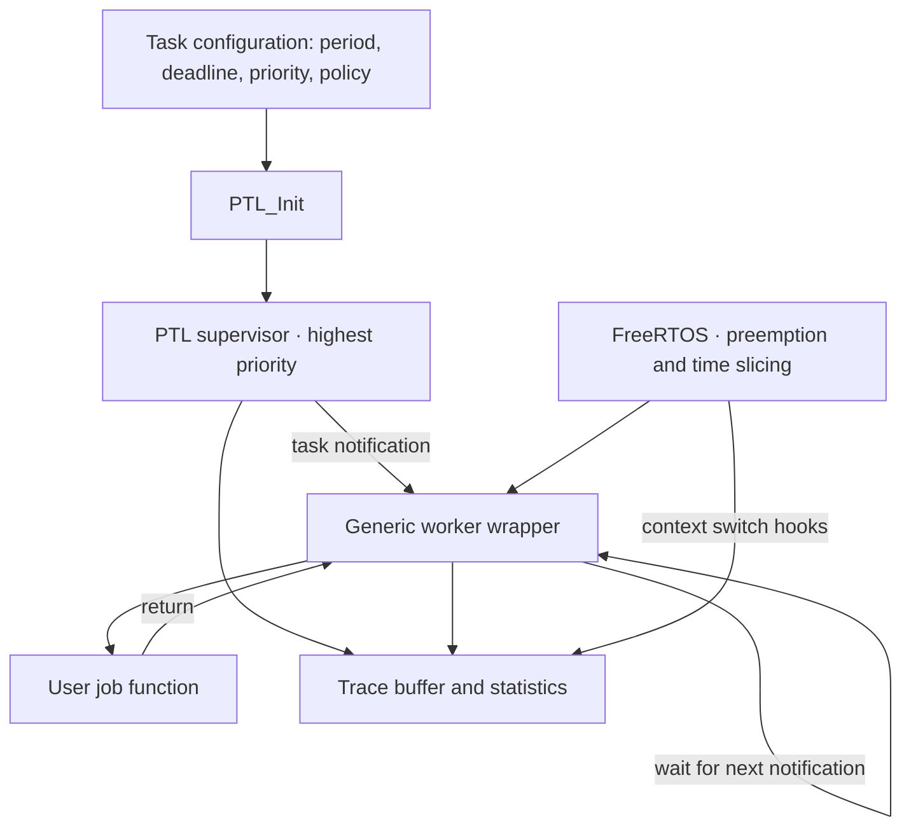

<div align="center">

# PTL · Periodic Task Layer

**Periodic releases, deadline monitoring and overrun policies on FreeRTOS.**

An embedded C project for the ARM Cortex-M3, running on QEMU.


[](LICENSE)

[Quick start](#quick-start) · [Architecture](#architecture) · [API](#configure-your-own-tasks) · [Tests](#testing) · [Documentation](#documentation)

</div>

## Overview

FreeRTOS decides **which ready task runs** using preemptive, priority-based scheduling. PTL adds a supervisor that decides **when periodic jobs are released**, monitors their deadlines, and applies a configurable policy when a job is still active at its next period.

Developed by **Group 38 at Politecnico di Torino**, this repository contains the middleware, a three-task demonstration, the bundled FreeRTOS kernel, an automated regression suite, and an interactive Python configurator.

| Capability | Implementation |
| --- | --- |
| Periodic jobs | Up to 8 tasks, each with a period, deadline, priority and job function |
| Scheduling | FreeRTOS preemption and time slicing; the supervisor uses priority 8 |
| Overrun handling | `SKIP`, `KILL` or `CATCH_UP`, globally or per task |
| Monitoring | Tick timestamps, context switches, deadline/overrun events and idle time |
| Regression checks | 10 QEMU scenarios and 6 host-side Python tests |
| Configuration | Interactive input, illustrative scheduling analysis and C generation |

**Target:** QEMU `mps2-an385`, ARM Cortex-M3, 1 kHz tick. The bundled kernel identifies itself as `V11.1.0+`; older `V202212.00` comments in project files are retained copyright headers, not a pinned kernel release.

## Quick start

From the repository root, with the dependencies below installed:

```bash
make                 # Build the demo
make qemu_start      # Run it in QEMU
```

Exit QEMU by pressing **Ctrl+A, then X**. Build artifacts are created in `Project/Output/main/`.

```bash
make tools_tests     # Check the Python tools
make tests           # Run all 10 firmware regression tests
```

The root Makefile forwards commands to `Project/`. The equivalent `make -C Project ...` commands also work. No physical board or Python packages are needed.

### Dependencies

| Tool | Used for |
| --- | --- |
| Complete Arm GNU Toolchain (`arm-none-eabi-gcc`, Newlib and binutils) | Cross-compiling and linking firmware |
| `qemu-system-arm` | Emulating the target board |
| GNU Make | Building the demo and tests |
| Python 3.8+ | Test runner and configuration tools; standard library only |
| `arm-none-eabi-gdb` | Optional debugging |

**macOS / Homebrew**

```bash
brew install --cask gcc-arm-embedded
brew install qemu python
```

Use the [complete embedded toolchain](https://formulae.brew.sh/cask/gcc-arm-embedded), which supplies `nano.specs`, `nosys.specs` and the C library. A compiler installed without those components cannot link this project.

**Ubuntu / Debian**

```bash
sudo apt update
sudo apt install build-essential gcc-arm-none-eabi binutils-arm-none-eabi libnewlib-arm-none-eabi qemu-system-arm python3
```

Check the selected compiler:

```bash
arm-none-eabi-gcc --version
arm-none-eabi-gcc -print-file-name=nano.specs
qemu-system-arm --version
python3 --version
```

The `nano.specs` check should return an existing path. If it only prints `nano.specs`, the selected toolchain is incomplete. See [Troubleshooting](#troubleshooting).

## Demo

[`Project/main.c`](Project/main.c) combines a short sensor job with two intentionally late workloads:

| Task | Period | Deadline | Priority | Nominal work | Policy |
| --- | ---: | ---: | ---: | ---: | --- |
| `Sensor` | 100 ms | 100 ms | 2 | `Burn(10)` | Global `CATCH_UP` |
| `ImgProc` | 50 ms | 50 ms | 1 | `Burn(80)` | `KILL` |
| `Logger` | 50 ms | 50 ms | 3 | `Burn(60)` | `SKIP` |

A higher priority number wins. The demo is deliberately overloaded to exercise policy handling. `Burn()` produces approximate CPU work after calibration; its argument is not a measured WCET or a guaranteed wall-clock duration.

UART output shows initialization, calibration and job execution. Regression tests additionally print traces and statistics. For example, the KILL test records:

```text
[  201 ms] Victim     DEADLINE_MISS
[  201 ms] Victim     OVERRUN_KILL
[  201 ms] Victim     RELEASE
[  201 ms] Victim     SWITCH_IN
[  201 ms] Victim     START
```

Timestamps are from a local QEMU run; they can differ across toolchains and runs.

## Architecture



The supervisor checks tasks every tick, updates the nominal release grid, and applies overrun policies. Workers wait for notifications, run one job body, record completion, and wait again. FreeRTOS performs the actual context switches; the PTL implementation does not replace its kernel scheduler.

| Policy | When the previous job is still active at a release |
| --- | --- |
| `SKIP` | Keep the current job; skip the new activation and advance the release grid |
| `KILL` | Delete and recreate the worker, then notify the new instance |
| `CATCH_UP` | Notify the existing worker again without aborting its current function; keep the nominal cadence |

A deadline miss is logged separately. **KILL happens at a period boundary**, not automatically at an earlier deadline. CATCH_UP uses coalescing notifications, with the limitations described in the [timing model](docs/TIMING_MODEL.md).

## Configure your own tasks

Write a function that performs **one job and returns**. PTL provides the surrounding infinite loop.

```c
#include "ptl.h"
#include "uart.h"
#include "burner.h"

static void sensor_job(void *argument)
{
    (void)argument;
    Burn(10);
}

int main(void)
{
    UART_init();
    static const PTL_GlobalConfig_t global = {
        .eOverrunPolicy = PTL_POLICY_SKIP,
        .xTracingEnabled = pdTRUE,
        .uxMaxTasks = 1
    };
    static const PTL_TaskConfig_t tasks[] = {{
        .pcName = "Sensor",
        .xPeriod = pdMS_TO_TICKS(100),
        .xDeadline = pdMS_TO_TICKS(80),
        .uxPriority = 2,
        .usStackDepth = 256,
        .pvEntryFunction = sensor_job,
        .pvParameters = NULL,
        .eOverrunPolicy = PTL_POLICY_USE_GLOBAL
    }};

    if (PTL_Init(&global, tasks, 1) == pdPASS) {
        PTL_Start();
    }
    for (;;) {}
}
```

Save a custom example as `Project/my_demo.c` and run:

```bash
make qemu_start ENTRY_POINT=my_demo.c
```

Each entry point gets its own output directory, so switching between the demo, tests and generated code does not reuse a stale executable. Header dependencies are tracked automatically.

### API reference

The public interface is in [`ptl.h`](Project/PTL/include/ptl.h).

| API | Purpose |
| --- | --- |
| `PTL_Init(global, tasks, count)` | Validate configuration and create workers; returns `pdPASS` or `pdFAIL` |
| `PTL_Start()` | Create the supervisor and start FreeRTOS; normally does not return |
| `PTL_GetTaskStats(index, jobs, misses, overruns)` | Read per-task counters |
| `PTL_GetTaskList(count)` | Access internal task objects for inspection |
| `PTL_GetEffectivePolicy(task)` | Resolve the per-task or global policy |
| `PTL_PrintTrace()` / `PTL_PrintStatistics()` | Print recorded events or a summary to UART |

Configuration rules:

- `1 <= task count <= uxMaxTasks <= 8`.
- Periods and deadlines are in **ticks**; `pdMS_TO_TICKS()` converts milliseconds.
- `xPeriod > 0`; `xDeadline == 0` defaults to the period; otherwise `0 < D <= T`.
- Worker priorities are `0..7` in this configuration. Prefer `1..7`; priority 8 is reserved for the supervisor.
- Stack depth is in **32-bit words**, at least `configMINIMAL_STACK_SIZE`; 256 words means 1024 bytes.
- Names must be nonempty and fit in 11 characters plus the terminator. Keep name strings and argument storage valid for the lifetime of the tasks.
- Call `PTL_Init()` once successfully, before starting the scheduler. Configuration is checked before any worker is created.

### Interactive configurator

```bash
make generate_config
```

The tool accepts up to eight tasks, checks names and timing parameters, prints utilization and an illustrative timeline, and generates `Project/main_gen.c`. It then offers to build and run the result. Generated source is preserved when you interrupt the tool.

```bash
make qemu_start ENTRY_POINT=main_gen.c
```

Its simulation omits overrun policies, kernel/trace overhead and FreeRTOS round-robin behavior. A successful preview is **not a schedulability proof**. Long hyperperiods are capped at a 10,000 ms preview.

## Testing

```bash
make tests
make run_single_test ENTRY_POINT=Tests/test_policy_kill_trace.c
make tests SHOW=1 SHOW_ON_SCREEN=1 TEST_DURATION=10
make tools_tests
```

`TEST_DURATION` is a host-time timeout in seconds, default 5. Bare-metal tests halt in a loop after their verdict; the runner terminates QEMU at the timeout and waits for it to exit. It requires a `[PASS]` marker and rejects failure/fatal/error markers, crashes and missing verdicts. A later PASS cannot hide an earlier FAIL.

| Firmware test | What it checks |
| --- | --- |
| `test_init_safety.c` | Start-before-init rejection, valid initialization, implicit deadline, global policy, repeated-init rejection |
| `test_safety_limits.c` | Invalid pointers, counts, policies, names, periods, deadlines, priorities and stack depths; valid retry |
| `test_policy_kill_trace.c` | Overrun termination and KILL evidence in the trace |
| `test_policy_skip_trace.c` | Skipped activations when the worker runs late |
| `test_policy_catchup_trace.c` | CATCH_UP overrun evidence |
| `test_preemption.c` | Higher-priority work preempts lower-priority work |
| `test_edge_minimal_gap.c` | Completion and overrun checks with a tight period |
| `test_mixed_trace.c` | Progress and aggregate overrun events with mixed policies |
| `test_production_check.c` | Workload-based overhead estimate against the 10% benchmark threshold |
| `test_load_on_trace.c` | High-frequency releases and trace-buffer stress |

Full logs are saved in `Project/logs/<test>.log`. `Project/qemu_test.log` contains a combined summary, or full output with `SHOW=1`. `SHOW_ON_SCREEN=1` also prints the selected output. Logs and build artifacts are excluded from Git.

[Local validation results](docs/VALIDATION.md) record the tested toolchain and scope. The [GitHub Actions workflow](.github/workflows/ci.yml) runs host checks, builds the demo and executes the QEMU suite. The [hosted run on 11 October 2026](https://github.com/Riccardo-Bartolini/PTL-FreeRTOS/actions/runs/38151395052) completed successfully.

## Debugging

```bash
# Terminal 1: build and start QEMU paused, with a GDB server
make qemu_debug

# Terminal 2: connect to the same entry point
make gdb_start
```

In GDB, use `break main`, then `continue`. Add `ENTRY_POINT=...` to both commands when debugging a test or custom application.

## Repository layout

```text
.
├── README.md                  # Overview, setup, usage and API
├── LICENSE                    # MIT license naming the four project authors
├── THIRD_PARTY_NOTICES.md      # Preserved upstream copyright and license notices
├── Makefile                   # Commands from the repository root
├── .github/workflows/ci.yml    # Build and regression workflow
├── docs/
│   ├── TIMING_MODEL.md         # Actual timing behavior and limitations
│   ├── Documentation.pdf      # Original technical report, preserved
│   ├── ASSIGNMENT.md           # Original project brief from the shared repository
│   ├── COMPARISON.it.md        # Comparison and integration decisions
│   ├── PUBLISHING.it.md        # Publish a fresh repository on your own profile
│   └── VALIDATION.md           # Local checks and their scope
├── FreeRTOS/                   # Bundled kernel and upstream ports
│   ├── LICENSE                # Kernel MIT notice; per-file notices are preserved
│   ├── include/
│   └── portable/
└── Project/
    ├── Makefile
    ├── FreeRTOSConfig.h
    ├── main.c                 # Three-task demo
    ├── startup.c              # Vector table and QEMU startup
    ├── mps2_m3.ld              # Target memory layout
    ├── PTL/
    │   ├── include/            # Public interfaces and event definitions
    │   └── source/             # Supervisor, wrapper and tracing
    ├── Utils/                 # UART and calibrated CPU burner
    ├── Tests/                 # 10 firmware regression scenarios
    └── Tools/                 # Configurator, QEMU runner and host tests
```

`FreeRTOS/` is bundled to allow a self-contained build. The Makefile compiles the Cortex-M3 GCC port, `heap_4.c`, and the required kernel sources. Directory names are case-sensitive: use `Utils/` and `PTL/source/` exactly as shown.

## Timing and portability

The supervisor scans at 1 ms intervals, with a common nominal release origin after burner calibration. Higher-priority workers can delay lower-priority job starts even when their releases share a tick.

This is an academic implementation validated on the included QEMU setup. The existing runtime has boundaries around tick wraparound, deadline equality, queued releases, CATCH_UP bookkeeping and tracing configuration. They are documented explicitly in the [timing model](docs/TIMING_MODEL.md). The tests exercise selected scenarios; they do not establish universal jitter or overhead guarantees.

## Troubleshooting

| Symptom | Check / fix |
| --- | --- |
| `stdlib.h` or `nano.specs` missing | Select the complete Arm GNU Toolchain with Newlib |
| Multiple ARM compilers installed | Check `command -v arm-none-eabi-gcc`; use `TOOLCHAIN_PREFIX=/absolute/path/bin/arm-none-eabi-` |
| No `[PASS]` before timeout | Inspect `Project/logs/<test>.log`; increase `TEST_DURATION` on a slow host |
| QEMU appears to keep running after PASS | The test intentionally halts; the runner will stop it at its timeout |
| Generated names do not compile | Use the configurator's unique ASCII identifiers, max 11 characters |
| Linux reports a missing source directory | Preserve the exact case of `Utils/` and `PTL/source/` |

```bash
# Example for the toolchain used during local validation on macOS
make TOOLCHAIN_PREFIX=/Applications/ArmGNUToolchain/13.3.rel1/arm-none-eabi/bin/arm-none-eabi-
make clean
```

`make clean` removes `Project/Output/`; generated configuration source and test logs are retained.

## Documentation

- [Timing model and implementation boundaries](docs/TIMING_MODEL.md)
- [Original technical report](docs/Documentation.pdf) — preserved as submitted; current Markdown documents describe subsequent changes.
- [Original assignment](docs/ASSIGNMENT.md)
- [Comparison of the two project copies — Italiano](docs/COMPARISON.it.md)
- [Publish on your own GitHub profile — Italiano](docs/PUBLISHING.it.md)
- [Validation evidence](docs/VALIDATION.md)

## Authors and acknowledgements

| Author | Contribution identified in the original source headers |
| --- | --- |
| **Riccardo Bartolini** | PTL supervisor and scheduling policies |
| **Rocco Caliandro** | PTL API, initialization and worker wrapper |
| **Gianmarco Fabbri** | Tracing, monitoring and statistics |
| **Davide Rossi** | Demonstration and configuration framework |

**Politecnico di Torino · Group 38 · Academic year 2025/2026**

Prepared from Riccardo's local project and the shared [PTL-FreeRTOS repository](https://github.com/Gianmarco-Fabbri/PTL-FreeRTOS), with integration decisions recorded in the comparison document. Publishing a fresh copy preserves these team credits and the original license notices.

The project is distributed under the [MIT license](LICENSE), naming the four Group 38 authors. Original notices from the shared repository are preserved in [THIRD_PARTY_NOTICES.md](THIRD_PARTY_NOTICES.md). FreeRTOS and bundled ports retain their original per-file copyright and licensing notices; see also [FreeRTOS licensing](https://freertos.org/libraries/license.html).
