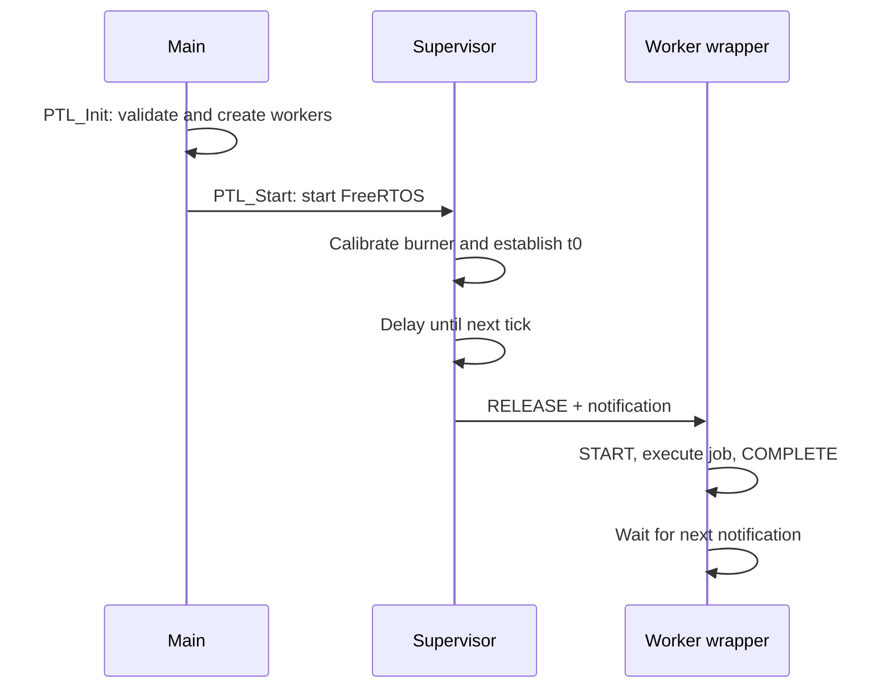

# PTL timing model

This document describes the implementation in `Project/PTL/source/`, including its boundaries. Periodic scheduling is layered above the bundled FreeRTOS kernel; preemption and time slicing remain kernel responsibilities.

## Configuration and units

The supplied `FreeRTOSConfig.h` uses a 1,000 Hz tick, nine priority levels, time slicing, 32-bit ticks and dynamic allocation with `heap_4.c`. The supervisor uses priority 8; workers must use priorities 0–7. `PTL_MAX_TASKS` is 8.

| Symbol | Meaning |
| --- | --- |
| T | Period in ticks; must be positive |
| D | Relative deadline in ticks; 0 defaults to T; otherwise D <= T |
| Rk | Nominal release time for job k |
| Fk | Completion time sampled by the wrapper |

`usStackDepth` counts words, not bytes. The CPU burner, printed trace labels and millisecond statistics assume the supplied 1 kHz configuration. Changing tick frequency requires corresponding changes to these components and the supervisor's 1 ms delay conversion.

## Startup and releases

1. `PTL_Init()` validates all inputs before creating worker tasks. A successful initialization can occur only once.
2. `PTL_Start()` creates the supervisor, then starts FreeRTOS.
3. The supervisor calibrates the burner for approximately 100 ticks while the scheduler is already running.
4. It records a common origin `t0` and initializes every next release to that origin.
5. The loop delays once before its first scan, so the first notifications are normally issued at `t0 + 1 tick`.
6. Subsequent nominal releases advance by T, independently of job completion.

The scan checks `now >= next_release`, advancing at most one period per scan. The RELEASE trace records the actual scan tick; the stored current-release field normally records the nominal grid time. Tasks released in the same scan do not necessarily start together: the highest-priority ready worker executes first.

## Deadline checks

The supervisor checks active jobs **before** processing releases. It records a miss when `now >= Rk + D` and the job has not already been marked missed. The wrapper checks completion with the strict comparison `Fk > Rk + D`, suppressing a second count if the supervisor has already marked it.

These comparisons differ at equality: an active job observed by the supervisor on its deadline tick may be counted as missed even though a completion at the same tick would pass the wrapper check. This is an inherited runtime boundary, not a universal strict-deadline guarantee.

A miss is logged; overrun policy enforcement happens when the **next period** arrives. For `D < T`, reaching D does not immediately kill the worker.

## Overrun policies

| Policy | Runtime action |
| --- | --- |
| SKIP | Increment the skip counter, keep the current job, and advance the next nominal release by T |
| KILL | Delete the worker, reset its active state, recreate it and notify the new instance |
| CATCH_UP | Increment the catch-up counter, update the current nominal release, clear the active flag and notify the existing worker |

KILL abandons the current function. Job code used with this policy must tolerate deletion: held locks, partially updated state and peripheral transactions are not automatically rolled back. Repeated recreation also requires heap capacity.

CATCH_UP does **not** interrupt or create a concurrent copy of the job function. Its notification remains pending until the current function returns. `ulTaskNotifyTake(pdTRUE, ...)` clears the notification count on consumption, so multiple pending releases can collapse into one execution. It is not a lossless queue of all missed jobs.

## Runtime boundaries retained from the original project

- **Ready versus active:** the wrapper sets `xIsActive` when it starts. A notified worker which has not yet run is not represented as an active job, so sustained priority starvation can create multiple RELEASE events before a START.
- **CATCH_UP bookkeeping:** the supervisor clears `xIsActive` and updates `xCurrentReleaseTime` while the old function can still be executing. Counters and deadline attribution under repeated overruns do not form a per-job ledger.
- **SKIP deadline flag:** the release scan resets `xDeadlineMissed` even when SKIP keeps the old job running. A job spanning several periods can produce repeated deadline-miss counts.
- **Tick wraparound:** absolute comparisons and deadline additions do not provide wrap-safe scheduling. At 1 kHz, a 32-bit tick wraps after approximately 49.7 days. Validation covers short runs only.
- **Tracing switch:** the global tracing flag controls wrapper logging and initialization, but supervisor and kernel hooks still log independently. Disabling all tracing requires changes to the hooks/build configuration.
- **Long critical sections:** code which masks interrupts or suspends scheduling can delay the supervisor. A 1-tick scan interval is not proof of a universal 1-tick jitter bound.

These points identify where a production-oriented extension would need additional runtime design and dedicated regression coverage. The publication cleanup preserves the project's scheduling approach rather than substituting a different scheduler.

## Trace and statistics

The trace holds 1,024 records in a circular buffer. New events overwrite old ones when full. Release, completion and overrun totals derived by `PTL_GetTraceStatistics()` therefore describe **retained events**, not necessarily lifetime totals. Idle accounting is accumulated separately, and the reported total time comes from the latest event timestamp.

The implementation records RELEASE, START, COMPLETE, DEADLINE_MISS, policy events, context switches and idle transitions. Printed times use the 1 kHz tick-to-millisecond equivalence.

CPU utilization is an idle-time estimate. Idle percentage is spare capacity; it is not scheduler overhead. `PTL_PrintStatistics()` no longer labels idle percentage as overhead. The separate production test estimates overhead by subtracting its assumed job workload from active time and comparing against 10%. Burner calibration, startup time and UART logging affect that estimate.

## Configurator analysis

`framework.py` previews fixed-priority scheduling at millisecond resolution, reports utilization, and detects unfinished jobs at their simulated deadlines. It checks all outstanding jobs, including those waiting behind a higher-priority task. Preview duration is at most 10,000 ms.

The model does not reproduce PTL overrun policies, kernel costs, interrupts, UART overhead or time slicing among equal priorities. Utilization below 100% is necessary for sustained CPU feasibility but is not sufficient to prove deadlines. Validate generated code with the actual QEMU workload.

## Portability scope

The validated target is the QEMU MPS2-AN385 with the GCC Cortex-M3 port, the supplied startup/vector table and ELF loader. The linker maps code at `0x00000000` and RAM at `0x20000000`, with 4 MiB regions. The minimal startup relies on QEMU loading the ELF's RAM sections; a hardware/flash port needs proper C runtime initialization and board-specific interrupt, UART and memory setup.

Other FreeRTOS ports are retained as bundled upstream sources. Their presence does not imply that PTL has been validated on them.
